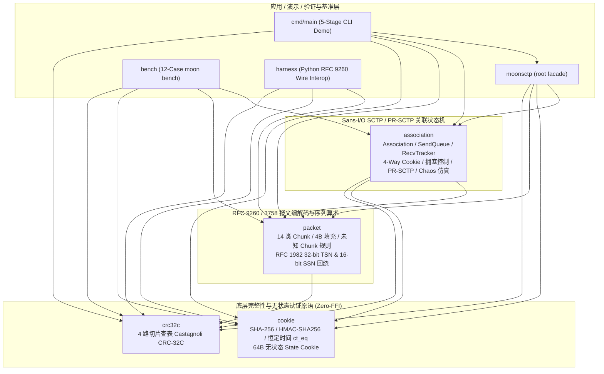

# MoonSCTP 架构设计与安全规范说明

> 模块名：`CoolrfulDARkness/moonsctp`  
> 目标标准：IETF **RFC 9260**（SCTP）、**RFC 3758**（PR-SCTP 部分可靠传输扩展）、**RFC 1982**（Serial Number Arithmetic）、**RFC 4231**（HMAC-SHA256）  
> 核心定位：**纯 MoonBit、零外部依赖、零 FFI、Sans-I/O** 的多流、消息导向、可配置部分可靠传输层协议栈（覆盖 WebRTC DataChannel 底层传输语义），同一套代码零修改编译运行于 `wasm` / `js` / `native` 三端。

---

## 1. 分层架构与包依赖拓扑

`moonsctp` 采用严格单向无环（DAG）分层设计：底层校验和、无状态 Cookie 密码认证与报文编解码完全独立；核心关联状态机采用纯 Sans-I/O 字节包喂入（`handle_packet`）与时钟驱动（`tick(now_ms)`）模型，彻底解耦底层传输介质（UDP/DTLS/内存通道/混沌仿真器），天然兼容 Wasm、JS 与 Native 三端。

### 1.1 包职责与 `.mbti` 公共接口边界

全仓子包均通过 `moon info` 生成 `pkg.generated.mbti` 固化对外 API 契约，CI 通过 `git diff --exit-code -- '*.mbti'` 严格防止公共接口意外漂移：

| 包路径 | 内部依赖 | 核心公开类型与函数（核对自各包 `pkg.generated.mbti`） | 封装边界 |
| :--- | :--- | :--- | :--- |
| `crc32c` | 无 | `Crc32c`（`new`/`update`/`update_view`/`finalize`）、`crc32c`、`crc32c_view`、`sctp_packet_checksum` | 零依赖；`Crc32c` 内部寄存器 `state` 严格 `priv` 隐藏（`// private fields`），4×256 切片表为包私有常量 |
| `cookie` | 无 | `COOKIE_WIRE_LEN`（64B）、`CookieError`（`InvalidLength`/`InvalidMac`/`Expired`）、`CookiePayload`（8 字段）、`sha256`、`hmac_sha256`、`ct_eq`、`seal_cookie`、`open_cookie` | 零依赖；`open_cookie` 先校验长度、再恒定时间验 HMAC、再校生命周期 |
| `packet` | `crc32c` | 14 项 `CHUNK_*` 常量、4 项 `FLAG_DATA_*` 常量、`COMMON_HEADER_LEN`（12B）、`PacketError`（8 变体）、`Packet`、`Chunk`（14 类变体）及各 Chunk 结构体、`encode_packet`、`decode_packet`、RFC 1982 `tsn_lt`/`tsn_le`/`tsn_gt`/`tsn_ge`/`tsn_diff`/`ssn_lt`/`ssn_le`/`ssn_inc` | 纯无状态线级编解码，严格校验小端 CRC-32C、4B 边界与未知 Chunk 策略 |
| `association` | `crc32c`, `cookie`, `packet` | `DEFAULT_*` 常量、`AssocError`（6 变体）、`AssocState`（8 状态）、`ReliabilityPolicy`（`Reliable`/`MaxRetransmits`/`TimedMs`）、`SendOptions`、`DeliveredMessage`、`Event`（6 变体）、`Config`（`default_client`/`default_server`）、`AssocStats`、`Association`（`new_client`/`new_server`/`process_stateless_init`/`connect`/`handle_packet`/`send`/`send_heartbeat`/`tick`/`poll_outbound`/`shutdown`/`abort`/`state`/`stats`） | `Association` 全部内部状态字段（发送队列、接收队列、`cookie_secret`、重放缓存、拥塞窗口、RTO、VTag）严格 `priv` 隐藏（`// private fields`） |
| `moonsctp`（根门面） | `association`, `cookie`, `packet`, `crc32c` | 顶层便捷入口：`crc32c`、`seal_cookie`、`open_cookie`、`encode_packet`、`decode_packet`、`new_client`、`new_server`、`process_stateless_init`、`client_config`、`server_config`、`reliable_opts`、`unordered_opts`、`partial_retransmit_opts`、`partial_timed_opts`、`run_handshake_loop` | 面向 `mooncakes.io` 用户的低门槛统一导入面 |

---

## 2. IETF 标准逐条款覆盖矩阵

### 2.1 已实现规范条款明细

| 标准与条款 | 规范特性 | 本项目实现位置 | 关键规范约束 |
| :--- | :--- | :--- | :--- |
| **RFC 9260 §3 & §6.8 / Appendix B** | 12B 公共头、Castagnoli CRC-32C 小端校验和与 4B 填充 | `crc32c/crc32c.mbt`, `packet/packet.mbt` | 校验和位于报文第 8..12 字节，计算时该 4B 置零并按 **little-endian** 写入；编码自动按 4 字节对齐补零，解码兼容末 Chunk 省略尾随填充并严格拒绝篡改 |
| **RFC 9260 §3.2** | 全部 14 类 Chunk 与未知 Chunk 高 2 位处理规则 | `packet/chunks.mbt` | 覆盖 `DATA`/`INIT`/`INIT_ACK`/`SACK`/`HEARTBEAT`/`HEARTBEAT_ACK`/`ABORT`/`SHUTDOWN`/`SHUTDOWN_ACK`/`ERROR`/`COOKIE_ECHO`/`COOKIE_ACK`/`SHUTDOWN_COMPLETE`/`FORWARD_TSN`；未知 Chunk 按高 2 位处理（`00`/`01` 抛 `UnknownCriticalChunk`，`10`/`11` 安全跳过） |
| **RFC 9260 §5.1** | 无状态抗 SYN Flood 4-Way Cookie 握手 | `cookie/hmac_sha256.mbt`, `association/assoc.mbt` | `INIT` → `INIT_ACK`（携带 64B HMAC-SHA256 Cookie TLV `0x0007`）→ `COOKIE_ECHO` → `COOKIE_ACK`；服务端通过 `process_stateless_init` 零会话内存分配签发 Cookie，收到 `COOKIE_ECHO` 后才建立关联 |
| **RFC 9260 §6.1 / §6.2 / §6.9** | 多流有序/无序消息交付与 B/E 分片重组 | `association/recv_queue.mbt`, `association/send_queue.mbt` | 按 `max_payload_size`（默认 1200B）自动切分 `B`/`E` 分片并捆绑；接收端为每条 `stream_id` 独立维护 `next_ssn` 与分片重组队列，彻底消除跨流队头阻塞；`U=1` 无序消息不占 SSN 直接交付 |
| **RFC 9260 §6.2 & §7.2** | SACK（Gap Ack Blocks + Duplicate TSNs）、快速重传与拥塞控制 | `association/recv_queue.mbt`, `association/send_queue.mbt` | 精确上报 `cum_tsn_ack`、`gap_blocks` 与 `dup_tsns`；支持 3 次缺失快速重传、Slow Start / Congestion Avoidance 拥塞窗口控制、Jacobson/Karels RTT/RTO 估算与 T3-rtx 指数退避 |
| **RFC 9260 §8.3 / §8.4 / §8.5** | Verification Tag 防注入、HEARTBEAT 保活与 ABORT 防伪造 | `association/assoc.mbt` | 强制校验报文 `verification_tag`（`INIT` 必须为 0，已建连必须匹配 `local_vtag`）；错 VTag 伪造 `ABORT` 静默忽略；支持 `HEARTBEAT` / `HEARTBEAT_ACK` 往返与 3-Way `SHUTDOWN` 优雅关闭 |
| **RFC 3758 §3.2 / §3.5 / §3.6** | PR-SCTP 部分可靠传输与 `FORWARD_TSN` (`0xC0`) 跳帧 | `packet/chunks.mbt`, `association/send_queue.mbt`, `association/recv_queue.mbt` | `INIT`/`INIT_ACK` 协商 `Forward-TSN-Supported` TLV（`0xC000`）；支持 `MaxRetransmits(n)`（最大重传次数）与 `TimedMs(ms)`（生存时长）两类放弃策略，超限后整消息放弃并发送 `FORWARD_TSN` 推进接收端 `cum_tsn_ack` 与受影响流的 `next_ssn` |
| **RFC 1982 §3.2** | 32-bit TSN 与 16-bit SSN 回绕安全序列算术 | `packet/serial.mbt` | 完整支持 `0xFFFFFFFF -> 0x00000000`（TSN）与 `0xFFFF -> 0x0000`（SSN）无缝回绕，并严格遵守 $2^{31}$ / $2^{15}$ 边界不可比语义 |

### 2.2 明确不在本期范围内的非目标边界（Scope Boundaries）

为保证核心传输协议栈保持零外部依赖、三端行为 100% 确定且聚焦核心多流/PR-SCTP 能力，以下特性**明确不在本期实现范围内**：

1. **多宿主（Multi-Homing）多 IP 路径管理与故障切换**：本期假定单逻辑传输通道（契合 WebRTC DataChannel over DTLS/UDP 单五元组模型），未实现多 IP 地址列表 TLV 与主备路径切换。
2. **RFC 4895（SCTP-AUTH 块级加密认证）**：数据加密与端点认证按 WebRTC 架构由下层 DTLS/TLCP 提供，本期不含 RFC 4895 `AUTH`/`RANDOM`/`CHUNKS` 扩展。
3. **RFC 6525（Stream Reconfiguration / 动态流重置）**：关联流数量在 `INIT`/`INIT_ACK` 握手阶段协商固定，不支持运行时动态增删或重置流 SSN。
4. **操作系统 UDP / Raw SCTP Socket FFI 绑定**：`moonsctp` 刻意设计为纯 Sans-I/O 协议核心，不含 POSIX/WinSock 套接字或系统定时器 FFI，由宿主应用提供收发通道与单调时钟 `now_ms`。

---

## 3. 核心架构与安全防御设计

### 3.1 4 路切片查表 Castagnoli CRC-32C 与单次验签热路径（`crc32c/crc32c.mbt`）

- 采用 Castagnoli 反射多项式 `0x82F63B78`（标准多项式 `0x1EDC6F41`），启动时一次性构建 4×256（1024 项）Slicing-by-4 查表 `tables[0..3]`，`Crc32c` 内部寄存器字段 `state` 严格标记 `priv`。
- 主循环每次吞吐 4 字节（32-bit 小端字）执行 4 次并行查表异或，尾部不足 4 字节退回单字节查表，在无 SIMD 依赖的纯 Wasm/JS/Native 环境下兼顾高吞吐与零分支简洁性。
- `sctp_packet_checksum` 对报文 `[0..8)` + 4 字节零值 + `[12..len)` 流式计算校验和，无需复制整包即可完成零拷贝验签；`association` 层 `decode_verified_packet` 直接复用单次 `@packet.decode_packet` 验签并捕获 `@packet.BadChecksum` 映射为 `SecurityViolation`，消除收包热路径双算开销。

### 3.2 无状态抗 SYN Flood HMAC-SHA256 Cookie 与防劫持边界（`cookie/` & `association/assoc.mbt`）

- 服务端调用静态入口 `Association::process_stateless_init(cfg, raw_init, now_ms)` 响应 `INIT`：严格校验 `dst_port == cfg.local_port && src_port != 0U`、零 VTag 及非零流数，在**不分配任何关联状态或接收/发送缓冲区**的前提下，将协商元数据（`local_vtag`、`peer_vtag`、`local_tsn`、`peer_tsn`、`out_streams`、`in_streams`、`peer_arwnd`、`created_ms` 共 32B）与 32B `HMAC-SHA256(cookie_secret, payload)` 封装为 64B State Cookie 随 `INIT_ACK` 返回。
- 收到 `COOKIE_ECHO` 时，强制要求服务端处于 `Closed` 状态（已建连等非 `Closed` 状态收到新 `COOKIE_ECHO` 立即抛出 `SecurityViolation`，杜绝合法 Cookie 覆写活跃会话的劫持攻击）；`open_cookie` 先校验长度（64B），再用无短路恒定时间 `@cookie.ct_eq` 验证 32B MAC，最后校验 `now_ms - created_ms <= cookie_lifetime_ms`（防过期 Cookie），并结合带 256 条 FIFO 容量上限的 `consumed_cookies` 重放表阻止重复建连与内存无限增长。

### 3.3 每流独立 `RecvTracker` 消除跨流队头阻塞与多层防 OOM 上限（`association/recv_queue.mbt`）

- 与 TCP 单一字节流模型不同，`RecvTracker` 将传输层 TSN 确认（全局 `cum_tsn_ack` + `gap_blocks`）与消息层流序交付彻底解耦：
  - 每个 `stream_id` 独立维护自己的 `next_ssn` 与 `B`/`E` 分片重组缓冲；
  - 当 Stream 0 的某个 TSN 丢失导致 Stream 0 暂缓交付时，Stream 1..N 上已集齐的有序消息与所有 `U=1` 无序消息**立即零延迟交付给应用层**；
  - 实施四层防 OOM DoS 硬上限：① 单条重组消息不超过 `Config.max_message_size`（默认 65536B）；② 全局接收缓冲不超过 `max(base_arwnd, max_message_size * 2)` 且每流 `pending_ordered` 槽数不超过 128；③ 乱序 TSN 前跳距离不超过 4096 且 `out_of_order_tsns` 不超过 1024；④ `build_sack()` 将 `gap_blocks` 与 `dup_tsns` 分别截断至最多 64 项，保证生成的 SACK 永不超出单包 65535B 编码限制。

### 3.4 RFC 1982 序列号回绕安全、未来 SACK 防护与 PR-SCTP 跳帧解锁

- 全栈对所有 TSN 比较统一调用 `packet.tsn_lt`/`tsn_le`/`tsn_gt`/`tsn_ge`/`tsn_diff`（32-bit 无符号半空间有符号差值），对 SSN 比较统一调用 `ssn_lt`/`ssn_le`/`ssn_inc`（16-bit 回绕），杜绝 `0xFFFFFFFF -> 0x00000000` 处的普通整型 `<` 比较失效。
- **未来确认与窗口溢出防护**：`SendQueue::on_sack` 与 `ack_up_to` 严格要求 `tsn_lt(cum_tsn, self.next_tsn)`（并忽略超出 `self.next_tsn` 的非法 Gap Block），防止恶意对端伪造超前 `cum_tsn_ack` 导致后续未发送数据被静默丢弃；对 `a_rwnd` / `base_arwnd` 采用饱和钳位 `u32_to_i32_sat`（`> 0x7FFFFFFFU` 钳位至 `0x7FFFFFFF`），防止 `a_rwnd >= 0x80000000U` 引发有符号 `Int32` 负数溢出锁死拥塞窗口。
- 在 PR-SCTP 模式下，当某条消息因 `MaxRetransmits(n)` 或 `TimedMs(ms)` 被发送端放弃时，发送端清理未确认分片并发送 `FORWARD_TSN(new_cum_tsn, streams)`；接收端仅在 `new_cum_tsn` 严格超前当前 `cum_tsn` 且前跳不超过窗口上限（`<= 4096`）时才推进 `cum_tsn_ack` 与受影响流的 `next_ssn`，彻底隔离过期/倒退 `FORWARD_TSN` 对有序流的破坏。

### 3.5 `priv` 严格封装、端口绑定与抗伪造报文防御

- `Association` 与 `Crc32c` 内部敏感状态字段均标记 `priv`（通过各包 `pkg.generated.mbti` 明确验证为 `// private fields`），防止外部绕过状态机直接篡改 `cookie_secret`、窗口、队列、重放表或 CRC 内部寄存器。
- 严格执行**端口绑定 + Verification Tag** 双重校验：`handle_packet` 强制校验 `dst_port == local_port` 与 `src_port == remote_port`（非 `Closed` 或配置非零远端端口时）以及 `verification_tag`（`INIT` 必须为 0，已建连必须匹配 `local_vtag`）；错 VTag 伪造 `ABORT` 静默免疫，合法首位及捆绑 `ABORT` 均完整释放收发队列并关闭关联。
