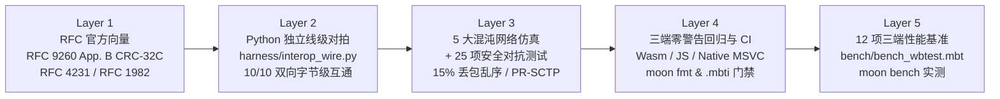

# MoonSCTP 工程验证日志与真实核验实录

> 对应 2026 MoonBit 黑客松评分维度 **04（开发与验证能力）**：记录 `CoolrfulDARkness/moonsctp` 的五层闭环验证体系、可复现验证命令，以及研发与跨语言线级对拍过程中**真实发生的核验与防错实录**。

---

## 1. 五层验证闭环体系

本项目构建“RFC 官方向量 + 零依赖 Python 独立线级双向对拍 + 确定性网络混沌仿真与 25 项安全对抗测试 + 三端零警告 CI 门禁 + 12 项跨后端基准”五层验证闭环：



### 1.1 各层验证覆盖明细

| 验证层级 | 测试文件 / 工具路径 | 覆盖明细 |
| :--- | :--- | :--- |
| **Layer 1：IETF 官方向量与编解码单测** | `crc32c/crc32c_test.mbt`、`cookie/cookie_test.mbt`、`packet/packet_test.mbt` | RFC 9260 Appendix B Castagnoli CRC-32C 官方向量（`"123456789"` → `0xE3069283` 等）；RFC 4231 HMAC-SHA256 官方向量与 64B State Cookie 封/解/过期/防篡改；RFC 1982 32-bit TSN & 16-bit SSN 回绕边界；全部 14 类 Chunk 编解码往返、非 4 倍数多 Chunk 捆绑与畸形长度/保留标志位拒绝 |
| **Layer 2：零依赖 Python 独立线级双向对拍** | `harness/interop_wire.py`、`harness/interop_cli/`、`harness/wire_vectors_generated_test.mbt` | **10/10 PASS（纯 Python 3 标准库，无第三方依赖）**：① Phase 1（MoonSCTP Wasm → 独立 Python 解包器，8/8 PASS）：独立无表按位 Castagnoli `0x82F63B78` CRC-32C、HMAC-SHA256 Cookie、以及 `INIT`/`INIT_ACK`/`COOKIE_ECHO+COOKIE_ACK`/`DATA(B/E/U)+SACK(Gap+Dup)`/`HEARTBEAT+HEARTBEAT_ACK`/`FORWARD_TSN+SHUTDOWN+ABORT` 共 6 类真实线级报文逐字段+4B 零填充+小端校验和核验；② Phase 2（Python 独立合成随机 RFC 9260 报文 → MoonSCTP Wasm & JS，2/2 PASS）：解包与重新 `encode_packet` 逐字节规范等价 |
| **Layer 3：确定性混沌网络仿真与 25 项安全对抗测试** | `association/chaos_test.mbt`、`association/adversarial_test.mbt` | **5 大混沌仿真场景**：完整 4-Way 握手+双向收发+心跳+3-Way 关闭、跨流无队头阻塞（丢弃 Stream 0 首包，Stream 1 零阻塞立即交付）、**15% 丢包 + 随机乱序 + 重复包**下 4 流 30 条含 >3KB 多分片 100% 无损收敛、RFC 3758 `MaxRetransmits(1)` + `TimedMs(150)` `FORWARD_TSN` 跳帧解锁、RFC 1982 `0xFFFFFFFC -> 0x00000000` 丢包回绕收敛；**25 项独立安全对抗测试**：单比特 CRC-32C 篡改、伪造/零 VTag、Cookie 篡改/过期/错密钥/重放、100 伪造 INIT 抗 SYN Flood、未握手注入、错 VTag 伪造 ABORT 静默免疫、发送与分片重组防 OOM、未知关键 Chunk、越界 Stream ID、重复 TSN 防重交且上报 `dup_tsns`、截断/畸形 Chunk DoS |
| **Layer 4：三端零警告回归与 CI 门禁** | `.github/workflows/ci.yml`（Linux + Windows MSVC） | 强制执行 `moon fmt --check`、`moon info && git diff --exit-code -- '*.mbti'`、`moon check -d`、`moon test --target wasm/js/native -d`（0 警告）以及 `python harness/interop_wire.py` 跨语言对拍 |
| **Layer 5：12 项跨后端性能基准** | `bench/bench_wbtest.mbt` | 使用白盒 `@bench.T` 覆盖 Castagnoli CRC-32C（1KB/16KB）、HMAC Cookie `seal`/`open`、`Packet` 1KB 编解码、多 Chunk 捆绑、无状态 `process_stateless_init`、完整 4-Way 握手、1KB DATA+SACK、8KB 7 分片重组与 4 流 16 消息并发交付 |

---

## 2. 真实工程核验与防错实录

以下 4 条记录均为本项目开发、线级对拍与混沌仿真过程中的真实核验细节：

### 实录 1：RFC 9260 §6.8 小端 CRC-32C 字节序经独立按位 Python 参考实现双向锁死

- **背景与风险**：SCTP 公共头前 8 字节（端口、Verification Tag）及 Chunk 头部全部为网络大端序（Big-Endian），但 **RFC 9260 §6.8 / Appendix B 明确规定第 8..12 字节的 Castagnoli CRC-32C 校验和按小端序（Little-Endian）写入**；若误按大端序写入，自测编解码虽然可以内部自洽，却会与 Linux 内核 / Wireshark / pion-sctp 等真实实现完全不互通。
- **核验与固化**：在 `harness/interop_wire.py` 中从零编写不依赖查表的纯按位多项式 `0x82F63B78` CRC-32C 参考函数与独立字节级解包器，双向对拍 MoonSCTP Wasm 产出的 6 类报文及 Python 独立合成的随机 RFC 9260 报文，10/10 逐字节吻合，从根源排除字节序自洽陷阱。

### 实录 2：RFC 9260 §3.2 未知 Chunk 高 2 位策略与末 Chunk 尾随填充兼容

- **背景与风险**：RFC 9260 §3.2 要求多 Chunk 捆绑时非末尾 Chunk 必须 4 字节零填充对齐，但末尾 Chunk 允许发送端省略尾随填充字节；同时遇到未知 Chunk 类型时必须严格按 Type 字节高 2 位决定行为（`00`/`01` 停止处理并报错，`10`/`11` 跳过该 Chunk 继续解析后续 Chunk）。
- **核验与固化**：`packet/packet.mbt` 与 `packet/chunks.mbt` 在编码端统一按 4B 对齐补零，在解码端对非末 Chunk 强制按 4B 步进、对末 Chunk 兼容无尾随填充报文，并在 `packet/packet_test.mbt` 与 `harness/interop_wire.py` 中对 1B/2B/3B/5B/13B/17B 等非 4 倍数载荷（含 `DATA`、`HEARTBEAT`、`ABORT` ErrorCause）完成全量双向回归校验。

### 实录 3：确定性混沌仿真（15% 丢包 + 乱序 + 重复包）验证无 HOL 阻塞与 TSN 回绕

- **背景与风险**：仅凭理想无损链路单测无法暴露丢包重传、重复包、跨流队头阻塞、PR-SCTP `FORWARD_TSN` 跳帧及 32-bit TSN `0xFFFFFFFF -> 0x00000000` 回绕交织时的状态机死锁或丢消息缺陷。
- **核验与固化**：在 `association/chaos_test.mbt` 构造确定性可复现 `ChaosLink` 仿真器，实跑 5 大高压力场景——包括 **15% 丢包 + 乱序 + 重复包下 4 条并发流 30 条消息（含 >3KB 多分片）100% 无损收敛**、丢弃 Stream 0 首包后 Stream 1 即时交付、`MaxRetransmits(1)` + `TimedMs(150)` 触发 `FORWARD_TSN` 跳帧解锁，以及初始 TSN=`0xFFFFFFFC` 在丢包场景下安全跨越 `0xFFFFFFFF -> 0x00000000` 无缝回绕。

### 实录 4：`Association` 内部敏感状态全量 `priv` 封装与 25 项安全对抗测试固化

- **背景与风险**：在 MoonBit 中，`pub struct` 字段若未显式标注 `priv` 则默认对外可读，对于持有机密 `cookie_secret`、内部队列及重放表的协议状态机而言会破坏封装安全边界。
- **核验与固化**：`association/assoc.mbt` 将 `Association` 全部内部字段标记为 `priv`（通过 `association/pkg.generated.mbti` 明确验证为 `// private fields`），并在 `association/adversarial_test.mbt` 固化 25 项独立安全对抗测试（覆盖 100 伪造 INIT 抗 SYN Flood、错 VTag 伪造 `ABORT` 静默免疫、Cookie 篡改/过期/重放及分片重组防 OOM）。

---

## 3. 可复现验证命令清单

### Linux / macOS

```bash
# 1. 格式与 .mbti 接口契约检查
moon fmt --check
moon info && git diff --exit-code -- '*.mbti'

# 2. 全库零警告类型检查与三端测试
moon check -d
moon test --target wasm -d
moon test --target js -d
moon test --target native -d

# 3. 零依赖 Python 独立 CRC-32C & RFC 9260 线级双向对拍
python3 harness/interop_wire.py

# 4. 5 阶段一键 CLI 实景演示
moon run cmd/main

# 5. 12 项跨后端性能基准测试
moon bench --target wasm bench
moon bench --target js bench
moon bench --target native bench
```

### Windows (PowerShell + MSVC Build Tools)

```powershell
$env:PATH = "$env:USERPROFILE\.moon\bin;$env:PATH"

# 1. 格式与接口检查
moon fmt --check
moon info; git diff --exit-code -- '*.mbti'

# 2. Wasm / JS 零警告全量回归
moon check -d
moon test --target wasm -d
moon test --target js -d

# 3. Native (MSVC) 零警告全量回归
cmd /c '"C:\Program Files (x86)\Microsoft Visual Studio\2022\BuildTools\VC\Auxiliary\Build\vcvars64.bat" >nul && moon test --target native -d'

# 4. 零依赖 Python 线级双向对拍 & CLI 演示
python harness/interop_wire.py
moon run cmd/main
```
