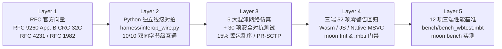

# MoonSCTP 工程验证日志与真实核验实录

> 对应 2026 MoonBit 黑客松评分维度 **04（开发与验证能力）**：记录 `CoolrfulDARkness/moonsctp` 的五层闭环验证体系、可复现验证命令，以及研发与跨语言线级对拍过程中**真实发生的核验与防错实录**。

---

## 1. 五层验证闭环体系

本项目构建“RFC 官方向量 + 零依赖 Python 独立线级双向对拍 + 确定性网络混沌仿真与 30 项安全对抗测试 + 三端零警告 CI 门禁（52 项全量测试）+ 12 项跨后端基准”五层验证闭环：



### 1.1 各层验证覆盖明细与全仓 52 项测试分布

| 验证层级 | 测试文件 / 工具路径 | 用例数 | 覆盖明细 |
| :--- | :--- | :---: | :--- |
| **Layer 1：IETF 官方向量与编解码单测** | `crc32c/crc32c_test.mbt`、`cookie/cookie_test.mbt`、`packet/packet_test.mbt` | **8** (`2 + 1 + 5`) | RFC 9260 Appendix B Castagnoli CRC-32C 官方向量（`"123456789"` → `0xE3069283` 等）；RFC 4231 HMAC-SHA256 官方向量与 64B State Cookie 封/解/过期/防篡改；RFC 1982 32-bit TSN & 16-bit SSN 回绕边界；全部 14 类 Chunk 编解码往返、非 4 倍数多 Chunk 捆绑与畸形长度/保留标志位拒绝 |
| **Layer 2：零依赖 Python 独立线级双向对拍** | `harness/interop_wire.py`、`harness/interop_cli/`、`harness/wire_vectors_generated_test.mbt` | **3**（+10/10 脚本互验） | **10/10 PASS（纯 Python 3 标准库，无第三方依赖）**：① Phase 1（MoonSCTP Wasm → 独立 Python 解包器，8/8 PASS）：独立无表按位 Castagnoli `0x82F63B78` CRC-32C、HMAC-SHA256 Cookie、以及 6 类真实线级报文逐字段+4B 零填充+小端校验和核验；② Phase 2（Python 独立合成随机 RFC 9260 报文 → MoonSCTP Wasm & JS，2/2 PASS）：3 组生成向量解包与 `encode_packet` 逐字节规范等价 |
| **Layer 3：确定性混沌网络仿真与 30 项安全对抗测试** | `association/chaos_test.mbt`、`association/adversarial_test.mbt` | **35** (`5 + 30`) | **5 大混沌仿真场景**：完整 4-Way 握手+双向收发+心跳+3-Way 关闭、跨流无队头阻塞（丢弃 Stream 0 首包，Stream 1 零阻塞立即交付）、**15% 丢包 + 随机乱序 + 重复包**下 4 流 30 条含 >3KB 多分片 100% 无损收敛、RFC 3758 `MaxRetransmits(1)` + `TimedMs(150)` `FORWARD_TSN` 跳帧解锁、RFC 1982 `0xFFFFFFFC -> 0x00000000` 丢包回绕收敛；**30 项独立安全对抗测试**：CRC-32C 篡改、伪造/零 VTag、Cookie 篡改/过期/错密钥/重放、100 伪造 INIT 抗 SYN Flood、未握手注入、错 VTag 伪造 ABORT 静默免疫、已建连服务端新 `COOKIE_ECHO` 防劫持、错误端口拦截、未来 `SACK(cum_tsn_ack >= next_tsn)` 防静默丢包、过期 `FORWARD_TSN` 防误推 SSN、超远乱序 TSN 洪泛防 OOM 及 `a_rwnd = 0x80000000U` 防窗口死锁 |
| **Layer 4：根门面与基准健壮性回归 + CI 门禁** | `moonsctp_test.mbt`、`moonsctp_wbtest.mbt`、`bench/bench_wbtest.mbt`、`.github/workflows/ci.yml` | **6** (`4 + 1 + 1`) | 根门面 API 与选项构造器黑盒/白盒回归（5 项）+ 基准套件正确性自检（1 项）；Linux & Windows MSVC 双平台 CI 强制 `moon fmt --check`、`moon info && git diff --exit-code -- '*.mbti'`、`moon check -d`、`moon test --target wasm/js/native -d`（全仓 **52/52** 零警告通过）及 `interop_wire.py` 跨语言对拍 |
| **Layer 5：12 项跨后端性能基准** | `bench/bench_wbtest.mbt` | **12 benches** | 使用白盒 `@bench.T` 覆盖 Castagnoli CRC-32C（1KB/16KB）、HMAC Cookie `seal`/`open`、`Packet` 1KB 编解码、多 Chunk 捆绑、无状态 `process_stateless_init`、完整 4-Way 握手、1KB DATA+SACK、8KB 7 分片重组与 4 流 16 消息并发交付 |

### 1.2 三端性能基准实测记录（`moon bench`）

本机（Windows AMD64，MoonBit `v0.10.22`，MSVC `14.44`）12 项基准实测结果（与 `README.mbt.md` 同源）：

| # | 基准项 | Wasm (`mean ± σ`) | JS (`mean ± σ`) | Native MSVC (`mean ± σ`) |
| :---: | :--- | ---: | ---: | ---: |
| 1 | Castagnoli CRC-32C (1KB) | 1.57 µs (~652 MB/s) | 1.73 µs (~592 MB/s) | **1.17 µs (~875 MB/s)** |
| 2 | Castagnoli CRC-32C (16KB) | 23.61 µs (~694 MB/s) | 27.59 µs (~594 MB/s) | **21.03 µs (~779 MB/s)** |
| 3 | HMAC-SHA256 Cookie `seal` | 3.73 µs ± 252 ns | 7.95 µs ± 498 ns | **2.82 µs ± 159 ns** |
| 4 | HMAC-SHA256 Cookie `open` | 4.12 µs ± 293 ns | 10.83 µs ± 1.44 µs | **3.03 µs ± 191 ns** |
| 5 | `Packet::encode_packet` (1KB DATA) | **9.97 µs ± 467 ns** | 42.65 µs ± 4.42 µs | 10.00 µs ± 598 ns |
| 6 | `Packet::decode_packet` (1KB + CRC-32C) | 3.37 µs ± 172 ns | 10.61 µs ± 1.33 µs | **2.48 µs ± 171 ns** |
| 7 | 多 Chunk 捆绑编解码 (DATA+SACK+HB) | 8.24 µs ± 208 ns | 47.84 µs ± 8.42 µs | **7.00 µs ± 449 ns** |
| 8 | 无状态 `process_stateless_init` | 5.63 µs ± 151 ns | 15.54 µs ± 1.63 µs | **5.14 µs (~195K/s)** |
| 9 | 完整 4-Way Cookie 握手端到端 | 22.20 µs (~45K/s) | 45.37 µs (~22K/s) | **16.65 µs (~60K/s)** |
| 10 | 单条 1KB DATA `send+handle+SACK` | 17.41 µs ± 814 ns | 73.63 µs ± 6.61 µs | **10.28 µs ± 336 ns** |
| 11 | 多分片 8KB (7 分片) 端到端重组交付 | 177.89 µs ± 17.65 µs | 558.66 µs ± 25.33 µs | **76.38 µs (~107 MB/s)** |
| 12 | 4 并发流 16 消息多流交付 | 227.89 µs ± 15.30 µs | 427.93 µs ± 35.23 µs | **78.44 µs (~204K msgs/s)** |

---

## 2. 真实工程核验与防错实录

以下 5 条记录均为本项目开发、线级对拍、混沌仿真与深度安全审计过程中的真实核验与修复细节：

### 实录 1：RFC 9260 §6.8 小端 CRC-32C 字节序经独立按位 Python 参考实现双向锁死

- **背景与风险**：SCTP 公共头前 8 字节（端口、Verification Tag）及 Chunk 头部全部为网络大端序（Big-Endian），但 **RFC 9260 §6.8 / Appendix B 明确规定第 8..12 字节的 Castagnoli CRC-32C 校验和按小端序（Little-Endian）写入**；若误按大端序写入，自测编解码虽然可以内部自洽，却会与 Linux 内核 / Wireshark / pion-sctp 等真实实现完全不互通。
- **核验与固化**：在 `harness/interop_wire.py` 中从零编写不依赖查表的纯按位多项式 `0x82F63B78` CRC-32C 参考函数与独立字节级解包器，双向对拍 MoonSCTP Wasm 产出的 6 类报文及 Python 独立合成的随机 RFC 9260 报文，10/10 逐字节吻合，从根源排除字节序自洽陷阱。

### 实录 2：RFC 9260 §3.2 未知 Chunk 高 2 位策略与末 Chunk 尾随填充兼容

- **背景与风险**：RFC 9260 §3.2 要求多 Chunk 捆绑时非末尾 Chunk 必须 4 字节零填充对齐，但末尾 Chunk 允许发送端省略尾随填充字节；同时遇到未知 Chunk 类型时必须严格按 Type 字节高 2 位决定行为（`00`/`01` 停止处理并报错，`10`/`11` 跳过该 Chunk 继续解析后续 Chunk）。
- **核验与固化**：`packet/packet.mbt` 与 `packet/chunks.mbt` 在编码端统一按 4B 对齐补零，在解码端对非末 Chunk 强制按 4B 步进、对末 Chunk 兼容无尾随填充报文，并在 `packet/packet_test.mbt` 与 `harness/interop_wire.py` 中对 1B/2B/3B/5B/13B/17B 等非 4 倍数载荷（含 `DATA`、`HEARTBEAT`、`ABORT` ErrorCause）完成全量双向回归校验。

### 实录 3：确定性混沌仿真（15% 丢包 + 乱序 + 重复包）验证无 HOL 阻塞与 TSN 回绕

- **背景与风险**：仅凭理想无损链路单测无法暴露丢包重传、重复包、跨流队头阻塞、PR-SCTP `FORWARD_TSN` 跳帧及 32-bit TSN `0xFFFFFFFF -> 0x00000000` 回绕交织时的状态机死锁或丢消息缺陷。
- **核验与固化**：在 `association/chaos_test.mbt` 构造确定性可复现 `ChaosLink` 仿真器，实跑 5 大高压力场景——包括 **15% 丢包 + 乱序 + 重复包下 4 条并发流 30 条消息（含 >3KB 多分片）100% 无损收敛**、丢弃 Stream 0 首包后 Stream 1 即时交付、`MaxRetransmits(1)` + `TimedMs(150)` 触发 `FORWARD_TSN` 跳帧解锁，以及初始 TSN=`0xFFFFFFFC` 在丢包场景下安全跨越 `0xFFFFFFFF -> 0x00000000` 无缝回绕。

### 实录 4：`Association` 与 `Crc32c` 内部敏感状态全量 `priv` 封装固化

- **背景与风险**：在 MoonBit 中，`pub struct` 字段若未显式标注 `priv` 则默认对外可读（`mut` 字段甚至对外可写），对于持有机密 `cookie_secret`、内部队列、重放表及 CRC 寄存器的协议核心而言会破坏封装安全边界。
- **核验与固化**：`association/assoc.mbt` 将 `Association` 全部内部字段标记 `priv`，`crc32c/crc32c.mbt` 将 `Crc32c.state` 标记 `priv`（通过各包 `pkg.generated.mbti` 明确验证为 `// private fields`），由 CI 的 `moon info && git diff --exit-code -- '*.mbti'` 永久守护。

### 实录 5：全仓对抗式深度安全审计与 3 项 P0 网络协议漏洞加固

- **背景与风险**：在功能测试与混沌仿真全部通过后，项目对 `association/`、`packet/`、`cookie/`、`crc32c/` 实施了独立的对抗式安全与 RFC 9260/3758 协议边界审计，检出 **3 项高危 P0 漏洞与 4 项 P1 加固项**：
  1. **P0-1 已建连 `COOKIE_ECHO` 会话劫持与端口未绑定**：服务端 `COOKIE_ECHO` 分支原未校验 `assoc_state == Closed`，且 `process_stateless_init`/`handle_packet` 未校验源/目的端口，攻击者可向已 `Established` 服务端注入新签发 Cookie 覆盖 `peer_vtag` 与收发队列，且 `consumed_cookies` 无上限；
  2. **P0-2 未来 `SACK`/`SHUTDOWN` `cum_tsn_ack >= next_tsn` 致后续数据静默丢弃**：`SendQueue::on_sack` 与 `ack_up_to` 原仅拦截倒退 TSN，未拒绝超前于 `next_tsn` 的未来确认，恶意对端可将 `peer_cum_tsn_ack` 推过 `next_tsn` 导致后续 `send()` 数据被 `prune_acked()` 误删；
  3. **P0-3 `RecvTracker` 多处内存无界 OOM DoS**：乱序 TSN 无前跳窗口与集合上限、`buffered_bytes` 未强制全局接收缓冲上限、每流 `pending_ordered` 无槽数上限、且 `build_sack` 未截断 `gap_blocks`/`dup_tsns`；
  4. **P1 加固项**：过期/倒退 `FORWARD_TSN`（`new_cum_tsn <= cum_tsn`）原仍会执行流 SSN 推进循环；`a_rwnd >= 0x80000000U` 直接 `reinterpret_as_int()` 会触发有符号 `Int32` 负数溢出锁死拥塞窗口；`decode_verified_packet` 热路径重复计算两次 CRC-32C；捆绑 `ABORT` 漏清收发队列；`Crc32c.state` 缺 `priv`。
- **修复与回归固化**：全量落地上述 P0/P1 修复——强制端口绑定与 `COOKIE_ECHO` 仅限 `Closed`、为 `consumed_cookies` 增加 256 条 FIFO 上限、严拒 `cum_tsn_ack >= next_tsn` 与越界 Gap Block、为 `RecvTracker` 施加 4096 前跳 / 1024 乱序 TSN / 全局缓冲 / 每流 128 槽 / SACK 64 项硬上限、将 `FORWARD_TSN` 流推进移入严格前跳守卫、引入 `u32_to_i32_sat` 饱和钳位、消除热路径双算 CRC-32C 并补齐捆绑 `ABORT` 清理；同步在 `association/adversarial_test.mbt` 新增 **5 项高危对抗回归测试**（对抗集由 25 项扩至 **30 项**，全仓三端测试达 **52/52** 零警告通过）。

---

## 3. 可复现验证命令清单

### Linux / macOS

```bash
# 1. 格式与 .mbti 接口契约检查
moon fmt --check
moon info && git diff --exit-code -- '*.mbti'

# 2. 全库零警告类型检查与三端测试
moon check -d
moon test --target wasm -d
moon test --target js -d
moon test --target native -d

# 3. 零依赖 Python 独立 CRC-32C & RFC 9260 线级双向对拍
python3 harness/interop_wire.py

# 4. 5 阶段一键 CLI 实景演示
moon run cmd/main

# 5. 12 项跨后端性能基准测试
moon bench --target wasm bench
moon bench --target js bench
moon bench --target native bench
```

### Windows (PowerShell + MSVC Build Tools)

```powershell
$env:PATH = "$env:USERPROFILE\.moon\bin;$env:PATH"

# 1. 格式与接口检查
moon fmt --check
moon info; git diff --exit-code -- '*.mbti'

# 2. Wasm / JS 零警告全量回归
moon check -d
moon test --target wasm -d
moon test --target js -d

# 3. Native (MSVC) 零警告全量回归
cmd /c '"C:\Program Files (x86)\Microsoft Visual Studio\2022\BuildTools\VC\Auxiliary\Build\vcvars64.bat" >nul && moon test --target native -d'

# 4. 零依赖 Python 线级双向对拍 & CLI 演示
python harness/interop_wire.py
moon run cmd/main
```
